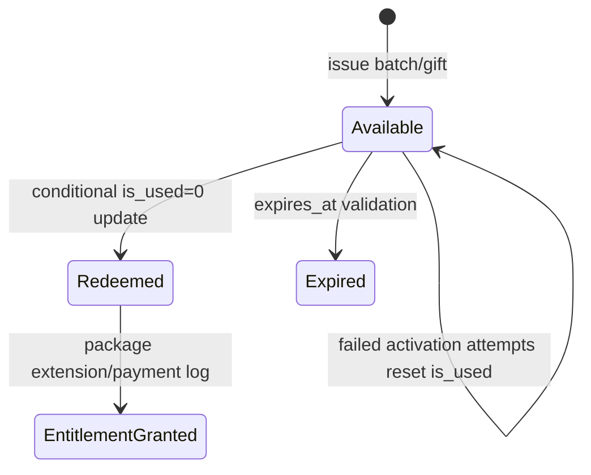
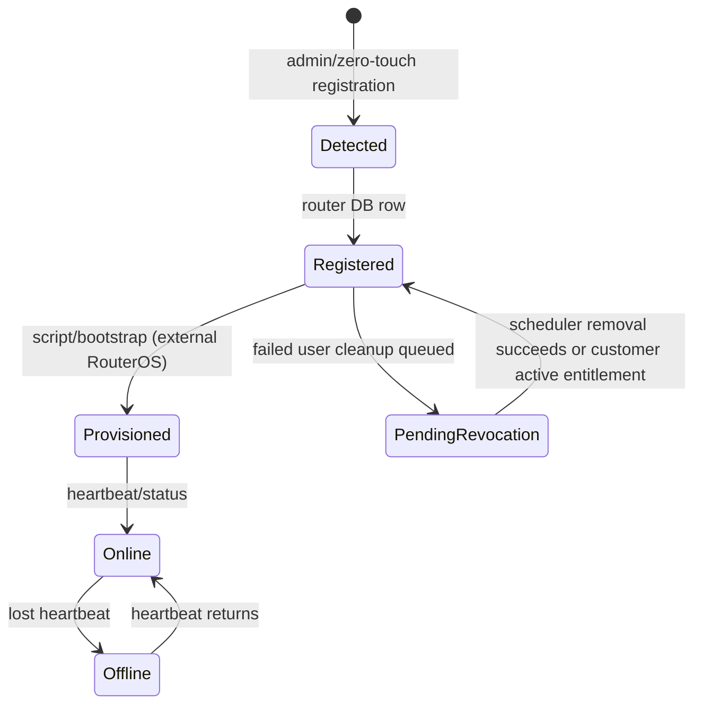
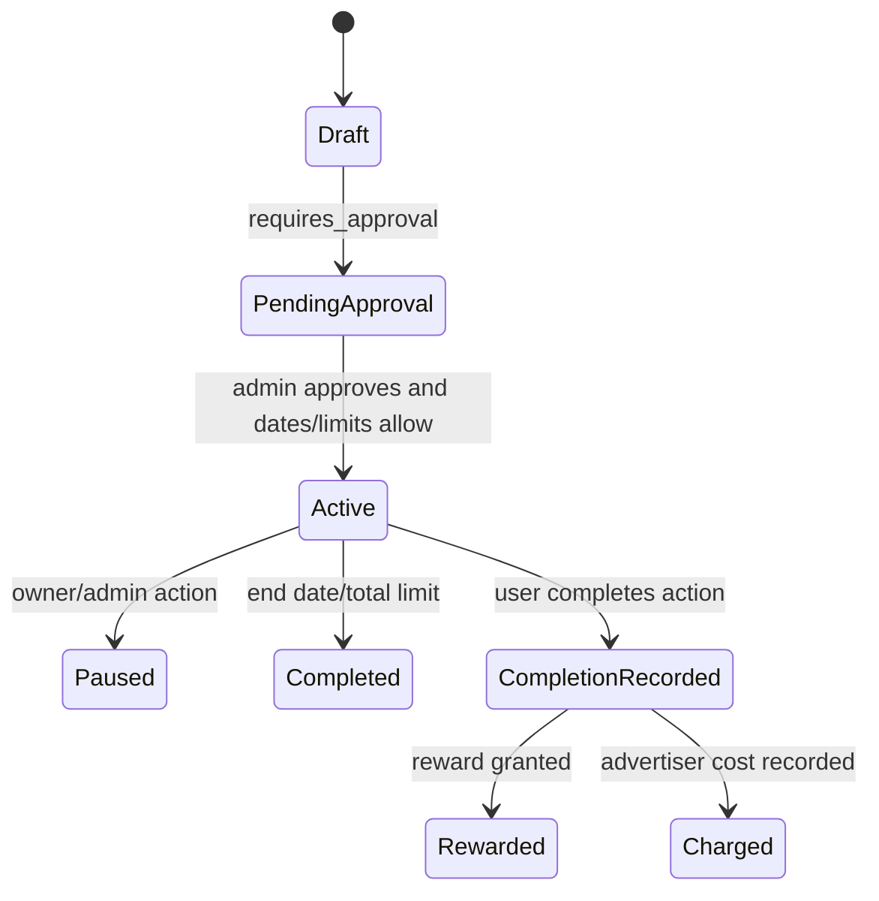

# State machines and stuck transitions

## Payment

```mermaid
stateDiagram-v2
  [*] --> PENDING: initiate; insert clickpesa_transactions
  PENDING --> PROCESSING: provider response / age poll
  PENDING --> SUCCESS: webhook or status query
  PROCESSING --> SUCCESS: provider confirms
  PENDING --> FAILED: provider response
  SUCCESS --> FULFILLED: lock transaction; grant package/wallet/voucher; processed=1
  SUCCESS --> SUCCESS: duplicate webhook; processed guard
  FULFILLED --> RECOVERY_CHECK: status poll sees processed package
  RECOVERY_CHECK --> FULFILLED: entitlement missing and no applied payment
  SUCCESS --> ERROR: DB fulfillment error; webhook returns 500 / reconciler may retry
```

Stuck risk: provider success with fulfillment failure depends on webhook/reconciler retry. `payment_ledger` insertion errors are swallowed after other fulfillment effects; ledger is not a required transition.

## Voucher

Stuck/partial: no transaction spans redeem, entitlement, payment history, and reseller balance/transaction (`hotspotController.js:1458-1527`). Concurrent claim guard exists, but side effects can partially commit.

## Router enrollment

Provisioning completion and owner approval are not consistently demonstrated. Bootstrap/provider behavior NOT VERIFIED.

## Customer entitlement

```mermaid
stateDiagram-v2
  [*] --> Guest
  Guest --> Free: register/advert reward
  Guest --> PaidPending: ClickPesa order
  PaidPending --> Paid: verified success + fulfillment
  Free --> Paid: package/voucher grant
  Paid --> Expired: usage_until elapsed
  Free --> Exhausted: free_bytes reaches zero
  Paid --> Exhausted: paid/free bytes exhausted
  Expired --> Disconnected: scheduler removes router record
  Exhausted --> Disconnected: scheduler sweep
  Any --> Suspended: is_active=0; revocation
  Suspended --> Active: unsuspend
```

Free/paid precedence is encoded in RADIUS, but policy for free bytes concurrent with paid time and data-cap boundaries must be confirmed.

## Reseller wallet/withdrawal

```mermaid
stateDiagram-v2
  [*] --> Funded: top-up or voucher/router sale
  Funded --> WithdrawalPending: request; debit/reserve balance
  WithdrawalPending --> Approved: admin review
  Approved --> PayoutSent: payout service
  PayoutSent --> Paid: provider confirms
  PayoutSent --> Pending: uncertain provider response/reconcile
  WithdrawalPending --> Rejected: admin rejects/refund
```

Separate `resellers.balance` and `wallets.balance` exist; commission and fee policy unresolved. Verify payout retries and idempotency with provider sandbox.

## Campaign

Possible partial transition: completion, budget charge, and reward are not proven atomic; legacy ads coexist with campaigns. Budget exhaustion mid-reward has no verified concurrency test.
